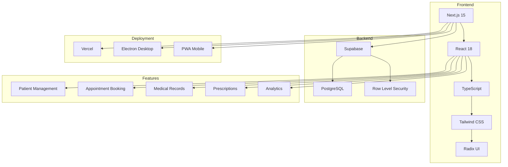

# 📚 Gonstead Chiropractic - Developer Documentation Hub

<div align="center">


**Comprehensive technical documentation for developers**

</div>

---

## 📑 Documentation Index

### 🎯 Quick Access

| Page/Module | Status | Complexity | Lines of Code | Documentation |
|-------------|--------|------------|---------------|---------------|
| [Admin Dashboard](./ADMIN_DASHBOARD.md) | ✅ Complete | 🔴 Advanced | ~5,600 | [View](./ADMIN_DASHBOARD.md) |
| Medical History | 🚧 Pending | 🟡 Intermediate | ~2,800 | Coming Soon |
| Prescription System | 🚧 Pending | 🔴 Advanced | ~4,200 | Coming Soon |
| Admin Analytics | 🚧 Pending | 🟡 Intermediate | ~1,200 | Coming Soon |
| Money Management | 🚧 Pending | 🟡 Intermediate | ~1,800 | Coming Soon |
| Patient Tracking | 🚧 Pending | 🟡 Intermediate | ~1,500 | Coming Soon |
| Authentication System | 🚧 Pending | 🟢 Basic | ~800 | Coming Soon |
| API Routes | 🚧 Pending | 🟡 Intermediate | ~1,000 | Coming Soon |
| Homepage/Booking | 🚧 Pending | 🟡 Intermediate | ~3,500 | Coming Soon |

---

## 🏗️ System Architecture Overview



---

## 🎨 Technology Stack

### Frontend
- **Framework**: Next.js 15.0.0
- **UI Library**: React 18.3.1
- **Language**: TypeScript 5.8.3
- **Styling**: Tailwind CSS 3.4.17
- **Component Library**: Radix UI + shadcn/ui
- **Icons**: Lucide React
- **Charts**: Recharts
- **Forms**: React Hook Form + Zod

### Backend
- **Database**: Supabase (PostgreSQL)
- **Authentication**: Supabase Auth
- **Storage**: Supabase Storage
- **Real-time**: Supabase Realtime

### Additional Services
- **Email**: EmailJS / Nodemailer
- **SMS**: Custom API integration
- **Analytics**: Vercel Analytics
- **Payments**: Stripe (future)
- **PDF Generation**: jsPDF + html2canvas

---

## 📖 Documentation Template

Each page documentation follows this comprehensive structure:

### 1. **Overview Section**
- Purpose and role in the system
- Key metrics (LOC, components, performance)
- File location and dependencies

### 2. **Features Overview**
- Detailed breakdown of all features
- Code examples for each feature
- Implementation highlights
- User flow diagrams

### 3. **Technical Implementation**
- Component structure tree
- State management patterns
- Data flow diagrams (Mermaid)
- Performance optimizations

### 4. **Developer Guide**
- How to add new features
- Customization examples
- Common patterns
- Best practices

### 5. **API Integration**
- All API endpoints used
- Request/response patterns
- Error handling
- Example implementations

### 6. **Security & Performance**
- Authentication/authorization
- Data validation
- Performance benchmarks
- Optimization techniques

### 7. **Troubleshooting**
- Common issues
- Solutions and workarounds
- Debugging tips
- FAQ

---

## 🚀 Getting Started

### For New Developers

1. **Read the Main README** - Start with the project overview
2. **Setup Environment** - Follow the [Setup Guide](../README.md#developer-quickstart)
3. **Explore Admin Dashboard** - [Read the docs](./ADMIN_DASHBOARD.md)
4. **Understand Data Flow** - Review architecture diagrams
5. **Run Locally** - `npm run dev`

### Quick Links

- [📦 Installation Guide](../README.md#developer-quickstart)
- [🔐 Environment Variables](./.env.example)
- [🗃️ Database Schema](./DATABASE_SCHEMA.md)
- [🎨 UI Components](./UI_COMPONENTS.md)
- [🔌 API Reference](./API_REFERENCE.md)

---

## 📋 Code Standards

### File Naming Conventions
```
✅ Good:
- admin-dashboard.tsx
- patient-tracking.tsx
- usePatientData.ts
- PatientCard.tsx

❌ Bad:
- AdminDashboard.tsx
- patient_tracking.tsx
- use-patient-data.ts
```

### Component Structure
```typescript
// 1. Imports (grouped)
import React from "react"
import { useState, useEffect } from "react"
import { useRouter } from "next/navigation"

// 2. Types/Interfaces
interface ComponentProps {
  // ...
}

// 3. Main Component
export default function Component({ props }: ComponentProps) {
  // 4. Hooks
  const router = useRouter()
  const [state, setState] = useState()
  
  // 5. Effects
  useEffect(() => {
    // ...
  }, [])
  
  // 6. Handlers
  const handleAction = () => {
    // ...
  }
  
  // 7. Render
  return (
    // JSX
  )
}
```

### Code Documentation
```typescript
/**
 * Fetches and processes patient data from Supabase
 * 
 * @param patientId - Unique patient identifier
 * @returns Promise<Patient> - Patient data with computed fields
 * @throws Error if patient not found or unauthorized
 * 
 * @example
 * const patient = await getPatient("123")
 */
async function getPatient(patientId: string): Promise<Patient> {
  // Implementation
}
```

---

## 🎯 Feature Documentation Status

### ✅ Completed

#### [Admin Dashboard](./ADMIN_DASHBOARD.md)
**Coverage**: 100% | **Last Updated**: Jan 2025

Comprehensive documentation covering:
- ✅ All 12 patient actions
- ✅ Session management system
- ✅ Smart filtering & sorting
- ✅ CSV import/export
- ✅ Dark mode implementation
- ✅ Real-time updates
- ✅ Appointment booking
- ✅ Security & authentication
- ✅ Performance optimizations
- ✅ Developer guide with examples

---

### 🚧 Pending Documentation

The following pages need documentation following the same comprehensive template:

#### 1. **Medical History Page**
**File**: `app/medical-history/page.tsx`
**Priority**: High
**Estimated LOC**: ~2,800

**Key Features to Document**:
- Patient medical record creation
- SOAP notes format
- Medical history tracking
- Document management
- Print functionality

#### 2. **Prescription System**
**File**: `app/admin/prescription/page.tsx`
**Priority**: High
**Estimated LOC**: ~4,200

**Key Features to Document**:
- Visual clinical tools
- Pain level assessment
- Exercise recommendations
- PDF generation
- Digital signatures
- QR code integration

#### 3. **Admin Analytics**
**File**: `app/admin/analytics/page.tsx`
**Priority**: Medium
**Estimated LOC**: ~1,200

**Key Features to Document**:
- Chart components
- Performance metrics
- Data visualization
- Export functionality

#### 4. **Money Management**
**File**: `app/admin/money-management/page.tsx`
**Priority**: Medium
**Estimated LOC**: ~1,800

**Key Features to Document**:
- Payment tracking
- Revenue analytics
- Receipt generation
- Financial reports

#### 5. **Patient Tracking**
**File**: `app/admin/patient-tracking/page.tsx`
**Priority**: Medium
**Estimated LOC**: ~1,500

**Key Features to Document**:
- Timeline visualization
- Treatment progress
- Session history
- Notes management

#### 6. **Authentication System**
**Files**: `app/admin/auth/page.tsx`, `app/staff-login/page.tsx`
**Priority**: High
**Estimated LOC**: ~800

**Key Features to Document**:
- Admin login flow
- Staff authentication
- Session management
- Security measures

#### 7. **API Routes**
**Files**: `app/api/*`
**Priority**: Medium
**Estimated LOC**: ~1,000

**Key Features to Document**:
- Endpoint specifications
- Request/response formats
- Authentication requirements
- Rate limiting

#### 8. **Homepage & Booking**
**File**: `app/page.tsx`
**Priority**: Medium
**Estimated LOC**: ~3,500

**Key Features to Document**:
- Smart appointment booking
- Conflict detection
- Form validation
- User interface

---

## 📊 Documentation Progress

```
Total Pages: 9
Completed: 1 (11%)
In Progress: 0 (0%)
Pending: 8 (89%)

Progress Bar:
[████░░░░░░░░░░░░░░░░░░░░░░░░░░░░░░░░] 11%
```

---

## 🔍 How to Use This Documentation

### For Understanding the Codebase
1. Start with the **System Architecture** section
2. Read the specific page documentation you need
3. Review the **Data Flow** diagrams
4. Check **API Integration** sections

### For Adding New Features
1. Read the **Developer Guide** in relevant page docs
2. Follow the **Code Standards** above
3. Check existing **Implementation Patterns**
4. Test using the patterns shown

### For Debugging
1. Check the **Troubleshooting** section
2. Review **Common Issues** in page docs
3. Use the **Performance Benchmarks** for comparison
4. Check **Security Implementation** if auth-related

### For Deployment
1. Review **Environment Variables**
2. Check **Database Schema**
3. Follow **Deployment Guide**
4. Test using **Health Checks**

---

## 🤝 Contributing to Documentation

### Adding New Documentation

1. **Create a new .md file** in `/docs` folder
2. **Use the template** structure (see Admin Dashboard example)
3. **Include**:
   - Overview with metrics
   - Detailed features with code examples
   - Technical implementation
   - Developer guide
   - Troubleshooting section
4. **Add to index** in this README
5. **Submit PR** with documentation

### Documentation Style Guide

- ✅ Use **clear headings** with emojis
- ✅ Include **code examples** for all features
- ✅ Add **diagrams** (Mermaid) for complex flows
- ✅ Provide **step-by-step guides**
- ✅ Include **troubleshooting** sections
- ❌ Don't use vague descriptions
- ❌ Don't skip code examples
- ❌ Don't forget about edge cases

---

## 📞 Support & Contact

### For Documentation Issues
- Create an issue on GitHub
- Tag with `documentation` label
- Provide specific section reference

### For Code Questions
- Check existing documentation first
- Review troubleshooting sections
- Create issue if problem persists

---

## 📝 Version History

| Version | Date | Changes | Author |
|---------|------|---------|--------|
| 1.0.0 | Jan 2025 | Initial documentation structure | Development Team |
| 1.1.0 | Jan 2025 | Added Admin Dashboard docs | Development Team |
| 1.2.0 | Pending | Medical History documentation | TBD |
| 1.3.0 | Pending | Prescription System docs | TBD |

---

## 🎓 Learning Resources

### Recommended Reading Order
1. [Main README](../README.md) - Project overview
2. [Admin Dashboard](./ADMIN_DASHBOARD.md) - Core functionality
3. [Database Schema](./DATABASE_SCHEMA.md) - Data structure
4. [API Reference](./API_REFERENCE.md) - Backend integration
5. [Security Guide](./SECURITY.md) - Security practices

### External Resources
- [Next.js Documentation](https://nextjs.org/docs)
- [Supabase Documentation](https://supabase.com/docs)
- [Tailwind CSS](https://tailwindcss.com/docs)
- [Radix UI](https://www.radix-ui.com/)
- [TypeScript Handbook](https://www.typescriptlang.org/docs/)

---

<div align="center">

## 🌟 Happy Coding! 🌟

**Built with ❤️ by the Development Team**

[Main Project](../README.md) | [Report Issues](https://github.com/muzairkattana/gonstead-chiropractic/issues) | [Contribute](../CONTRIBUTING.md)

</div>

