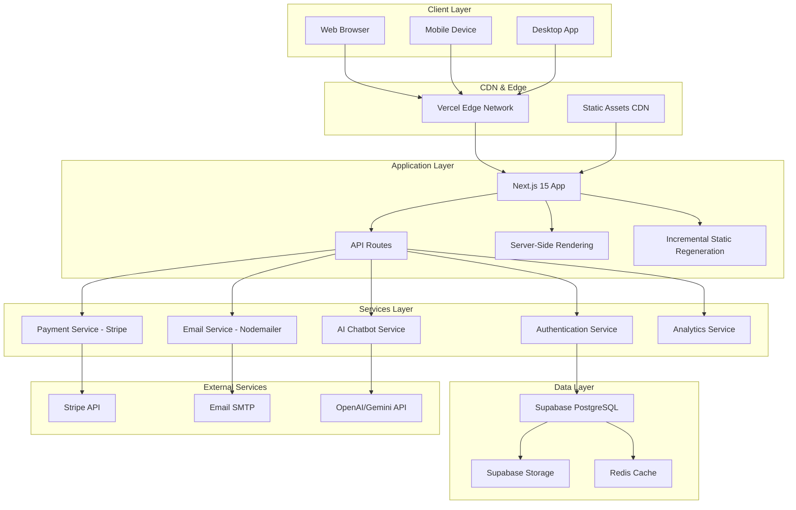

# System Architecture

High-level overview of the Gonstead Chiropractic system architecture showing all layers from client to data.

## Description

This diagram illustrates the complete system architecture with:

- **Client Layer**: Multi-platform access (Web, Mobile, Desktop)
- **CDN & Edge**: Global content delivery via Vercel
- **Application Layer**: Next.js 15 with SSR and ISR capabilities
- **Services Layer**: Modular microservices for auth, payments, email, AI, and analytics
- **Data Layer**: Supabase PostgreSQL with storage and caching
- **External Services**: Third-party integrations (Stripe, SMTP, OpenAI/Gemini)

