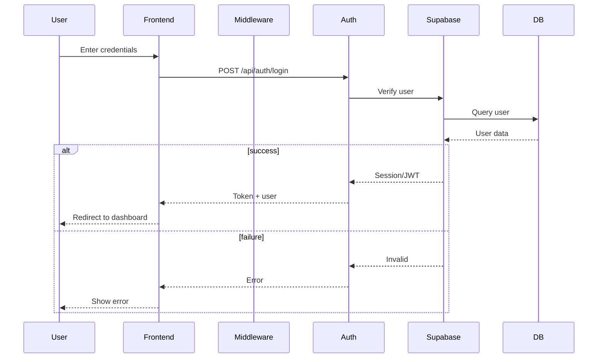
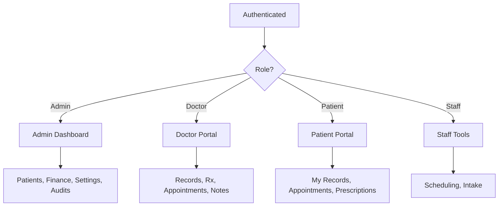

# Authentication & Authorization

## Login Sequence

## Role-Based Access Control (RBAC)

## Description

### Login Sequence
Shows the complete authentication flow from credential submission through JWT token generation and dashboard redirect.

### RBAC
Demonstrates how different user roles are routed to appropriate dashboards with specific permissions:
- **Admin**: Full system access
- **Doctor**: Clinical tools and patient management
- **Patient**: Personal health information
- **Staff**: Operational tools

