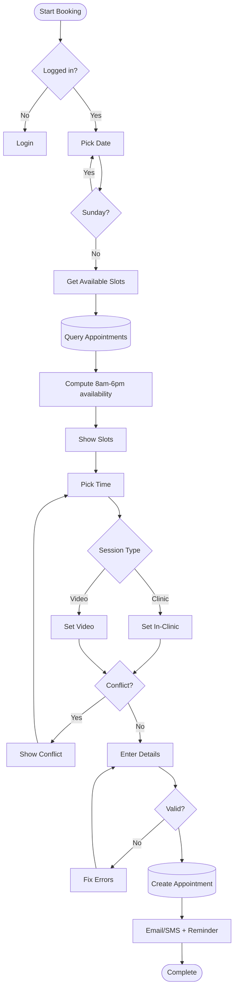

# Appointment Booking Flow

Complete workflow for booking appointments through the public website or patient portal.

## Description

This flowchart demonstrates:

1. **Authentication**: User must be logged in
2. **Date Selection**: Excludes Sundays (clinic closed)
3. **Slot Availability**: Real-time checking against existing appointments
4. **Session Type**: Choice between in-clinic or video consultation
5. **Conflict Detection**: Prevents double-booking
6. **Validation**: Ensures all required information is provided
7. **Confirmation**: Automated email/SMS notifications and reminders

**Key Features**:
- Operating hours: 8 AM - 6 PM
- Closed: Sundays
- Real-time conflict detection
- Automated notifications

