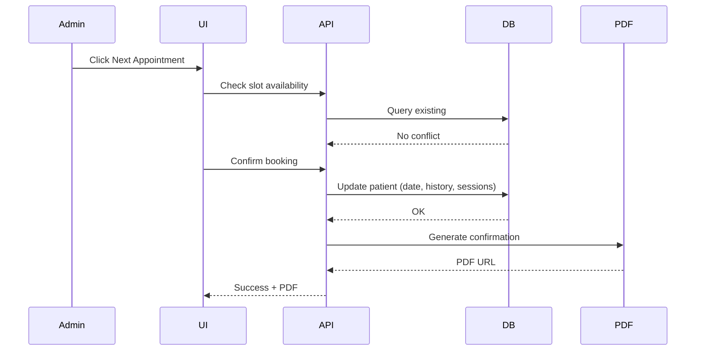

# Next Appointment Scheduling

Admin-initiated follow-up appointment booking from patient dashboard.

## Description

This sequence diagram shows the streamlined process for scheduling follow-up appointments:

1. **Admin Initiation**: Admin clicks "Next Appointment" from patient record
2. **Availability Check**: System queries database for slot conflicts
3. **Booking Confirmation**: Admin confirms the selected slot
4. **Database Update**: Patient record updated with:
   - New appointment date/time
   - Appointment history
   - Session counter increment
5. **PDF Generation**: Automatic confirmation document creation
6. **Success Response**: UI receives confirmation with downloadable PDF

**Benefits**:
- Fast follow-up scheduling
- Automatic record updates
- Instant confirmation documents
- Seamless integration with patient history

