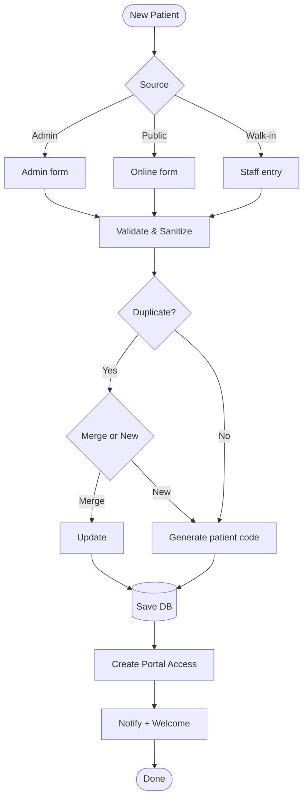

# Patient Registration & Data Flow

Complete patient onboarding process with multiple entry points and duplicate detection.

## Description

This flowchart illustrates the flexible patient registration system:

### Entry Points
1. **Admin Form**: Manual entry by administrative staff
2. **Online Form**: Self-registration via public website
3. **Walk-in**: Quick entry for walk-in patients

### Key Processes

#### Validation & Sanitization
- Input validation for all fields
- Phone/email format verification
- Data sanitization for security

#### Duplicate Detection
- Email and phone matching
- Name similarity checking
- Prevents duplicate records

#### Patient Code Generation
- Unique identifier format: `GONSTEAD-XXXX`
- Sequential numbering
- Used for record tracking

#### Portal Creation
- Secure login credentials
- Patient dashboard access
- Appointment management capabilities

#### Notifications
- Welcome email with portal instructions
- Account credentials (secure delivery)
- Educational materials

**Security Features**:
- HIPAA-compliant data handling
- Encrypted storage
- Audit trail logging

