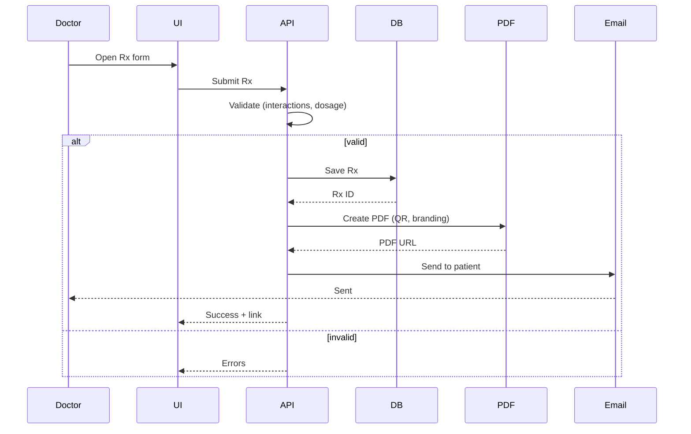

# Prescription Generation Flow

Doctor-initiated prescription creation with validation and PDF delivery.

## Description

This sequence demonstrates the prescription workflow:

### Validation Steps
- **Drug Interaction Checking**: Cross-references against patient's current medications
- **Dosage Verification**: Ensures safe dosage ranges
- **Allergy Checking**: Validates against patient allergies
- **Regulatory Compliance**: Follows prescription guidelines

### PDF Generation
The generated prescription includes:
- Doctor's information and signature
- Patient details
- Medication name, dosage, frequency
- Instructions for use
- QR code for verification
- Clinic branding and contact info

### Delivery
- **Email**: Instant delivery to patient's registered email
- **Portal**: Available in patient dashboard
- **Print**: Downloadable PDF for pharmacy

### Error Handling
If validation fails:
- Specific error messages displayed
- Suggestions for corrections
- Re-submission option

**Security Features**:
- QR code for authenticity verification
- Digital signature
- Tamper-proof PDF
- Access logging

