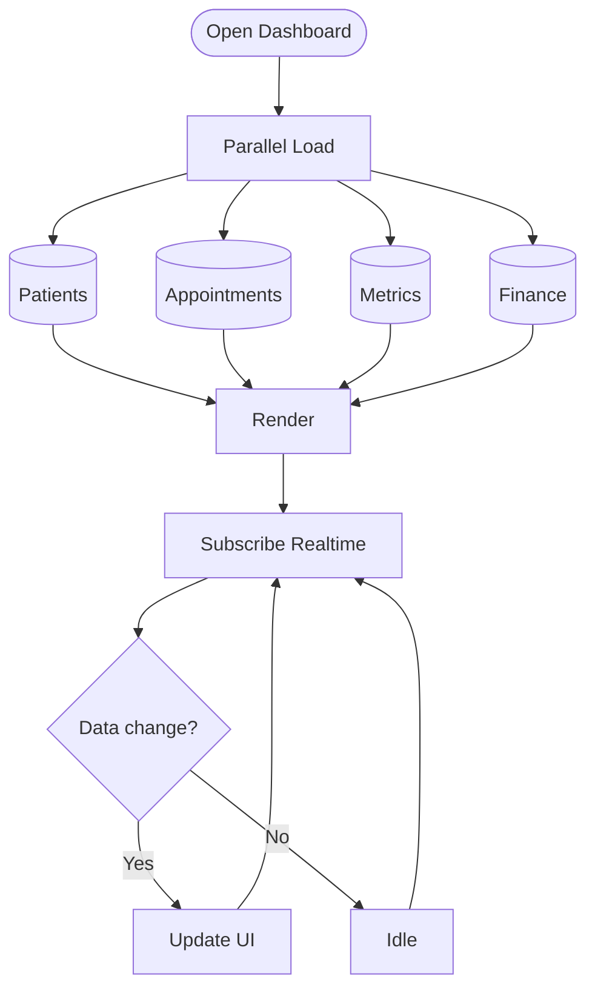

# Admin Dashboard Data Flow & Realtime Updates

Parallel data loading and real-time synchronization for the admin dashboard.

## Description

The admin dashboard uses an optimized data loading strategy:

### Parallel Loading
Four key data sources load simultaneously:
1. **Patients**: Total count, new registrations, active patients
2. **Appointments**: Today's schedule, upcoming, cancellations
3. **Metrics**: Revenue, patient satisfaction, system performance
4. **Finance**: Payments, outstanding balances, revenue trends

### Rendering Strategy
- All data loads in parallel (non-blocking)
- Dashboard renders as data arrives
- Skeleton loaders for pending sections
- Progressive enhancement

### Real-time Updates
Using Supabase Realtime subscriptions:
- **Patient Changes**: New registrations, profile updates
- **Appointment Changes**: New bookings, cancellations, status updates
- **Payment Events**: New payments, refunds
- **System Metrics**: Live performance data

### Performance Optimizations
- **Lazy Loading**: Charts load on scroll/tab activation
- **Caching**: Redis cache for frequently accessed data
- **Debouncing**: Updates batched (max 1/second)
- **Pagination**: Large datasets loaded incrementally

### Update Flow
1. User opens dashboard
2. Initial data loads in parallel
3. WebSocket connection established
4. Real-time subscription activated
5. UI updates automatically on data changes
6. No manual refresh needed

**Benefits**:
- Sub-2s initial load time
- Live data without polling
- Reduced server load
- Smooth user experience

