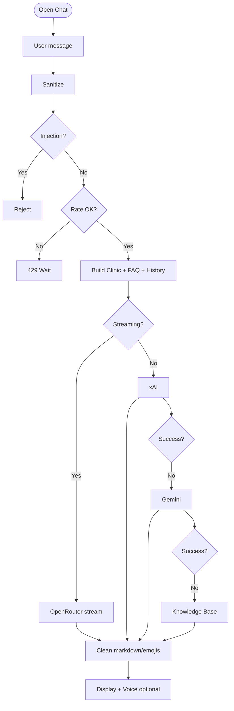

# AI Chatbot Flow

Intelligent medical chatbot with streaming responses and multiple fallback providers.

## Description

The AI chatbot provides 24/7 patient support with advanced features:

### Security Layer
1. **Input Sanitization**: Removes malicious content
2. **Injection Detection**: SQL/XSS/prompt injection prevention
3. **Rate Limiting**: 30 messages per minute per user
4. **Content Filtering**: Inappropriate content blocking

### Context Building
The bot receives:
- **Clinic Info**: Services, hours, location, staff
- **FAQ Database**: Common questions and answers
- **Conversation History**: Last 10 messages for context
- **Patient Data** (if logged in): Medical history, appointments

### AI Provider Cascade
Three-tier fallback system for reliability:

#### Tier 1: OpenRouter (Streaming)
- **Model**: GPT-4 Turbo or Claude 3
- **Feature**: Real-time streaming responses
- **Use Case**: Interactive conversations
- **Fallback Trigger**: API timeout or error

#### Tier 2: xAI (Grok)
- **Model**: Grok-2
- **Feature**: Fast responses
- **Use Case**: Quick queries
- **Fallback Trigger**: Service unavailable

#### Tier 3: Gemini
- **Model**: Gemini Pro
- **Feature**: Multimodal support
- **Use Case**: Complex medical queries
- **Fallback Trigger**: All others failed

#### Tier 4: Knowledge Base
- **Type**: Local embeddings search
- **Feature**: Offline capability
- **Use Case**: Basic FAQ matching
- **Reliability**: 100% availability

### Response Processing
- **Markdown Cleaning**: Removes broken formatting
- **Emoji Normalization**: Consistent emoji rendering
- **Link Validation**: Ensures safe URLs
- **Length Limiting**: Prevents overly long responses

### Optional Features
- **Text-to-Speech**: Voice responses for accessibility
- **Translation**: Multi-language support
- **Citation**: Sources for medical information

**Capabilities**:
- Symptom assessment
- Appointment guidance
- Treatment information
- Clinic policies
- General health education

**Limitations Disclosed**:
- Not a substitute for professional diagnosis
- Emergency cases redirected to 911
- Complex cases referred to doctor

