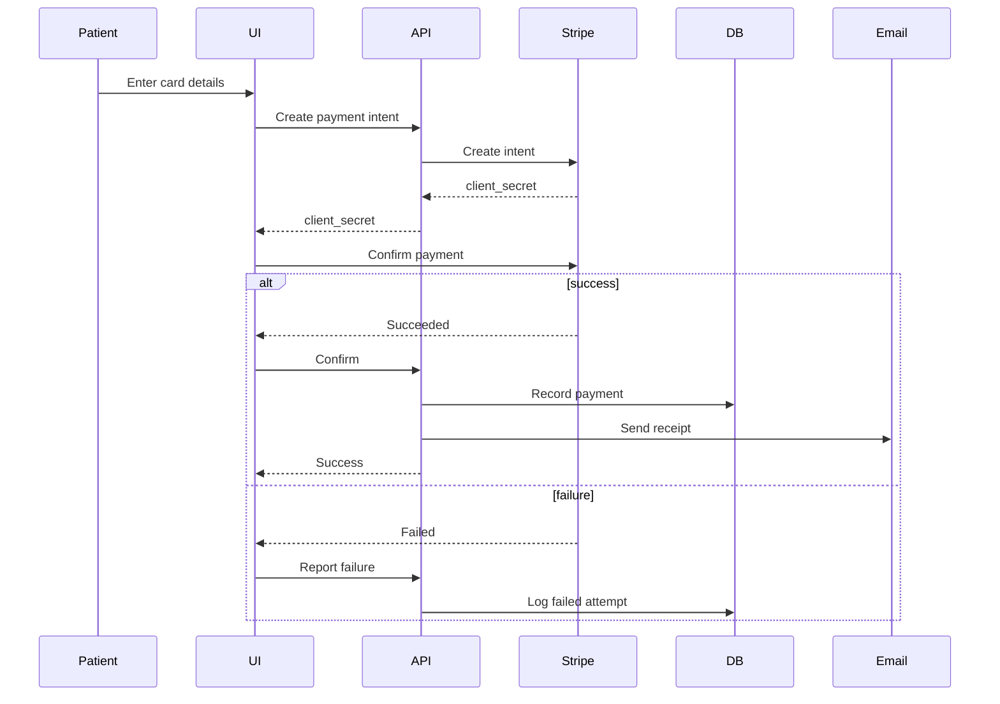

# Payment Processing Flow

Secure payment handling using Stripe with automatic receipts and reconciliation.

## Description

Secure payment processing using Stripe's recommended payment flow:

### Payment Intent Flow
Stripe's latest approach for SCA (Strong Customer Authentication) compliance:

1. **Client**: Patient enters card details in secure form
2. **Server**: Creates Payment Intent with amount and metadata
3. **Stripe**: Returns `client_secret` for client-side confirmation
4. **Client**: Confirms payment with Stripe.js (3D Secure if needed)
5. **Stripe**: Processes payment and returns result
6. **Server**: Receives confirmation and records transaction

### Security Features
- **No Card Data Storage**: Never touches server
- **PCI Compliance**: Stripe handles all card data
- **3D Secure**: Automatic authentication for supported cards
- **Fraud Detection**: Stripe Radar enabled
- **Secure Tokens**: client_secret valid for single use

### Success Flow
When payment succeeds:
1. **Database Recording**:
   - Payment ID, amount, date
   - Patient linkage
   - Appointment association
   - Payment method (last 4 digits)
   
2. **Receipt Generation**:
   - PDF with clinic branding
   - Transaction details
   - Payment method
   - Service description
   
3. **Email Delivery**:
   - Instant receipt to patient
   - Copy to clinic records
   - Downloadable PDF attachment

### Failure Handling
When payment fails:
1. **User Notification**: Clear error message
2. **Logging**: Failed attempt recorded (for fraud detection)
3. **Retry Option**: Patient can try again or use different card
4. **Admin Alert**: High-value failures flagged

### Supported Payment Methods
- ✅ Credit Cards (Visa, Mastercard, Amex)
- ✅ Debit Cards
- ✅ Apple Pay
- ✅ Google Pay
- ✅ Link (Stripe's one-click payment)

### Transaction Metadata
Every payment records:
- Patient ID and name
- Appointment ID
- Service type
- Doctor name
- Clinic location
- Invoice number

### Reconciliation
- Automatic daily reconciliation
- Stripe webhooks for real-time updates
- Discrepancy detection and alerts
- Financial reports generation

**Compliance**:
- PCI DSS Level 1
- GDPR compliant
- HIPAA considerations for payment data

