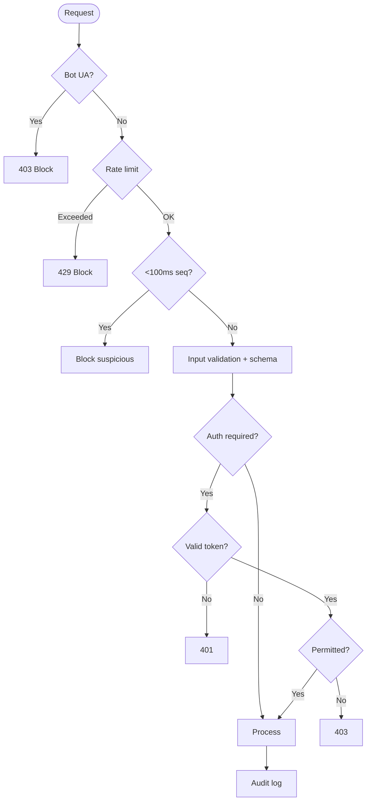

# Security & Bot Protection

Multi-layered security system protecting against scraping, bots, and unauthorized access.



## Description

Enterprise-grade security implementation with multiple protection layers:

### Layer 1: Bot Detection
**User Agent Analysis** - Blocks 40+ known scraping tools:
- Scrapy, Selenium, PhantomJS, Puppeteer
- curl, wget, python-requests
- Headless browsers (Chrome, Firefox)
- Custom detection for disguised bots

**Behavioral Analysis**:
- Mouse movement patterns (human vs. programmatic)
- Keyboard timing analysis
- Touch gesture detection
- Viewport and screen size anomalies

### Layer 2: Rate Limiting
**Per-IP Limits**:
- 30 requests per minute (normal users)
- 5 login attempts per 15 minutes
- 3 password reset requests per hour

**Per-User Limits**:
- 100 API calls per hour (authenticated)
- 10 appointment bookings per day
- 50 chat messages per session

**Adaptive Rate Limiting**:
- Temporarily reduces limits during attacks
- Increases limits for verified users
- Geographic-based adjustments

### Layer 3: Sequential Request Detection
**Timing Analysis**:
- Blocks requests <100ms apart (bot-like)
- Monitors request patterns
- Detects automation frameworks

**Anomaly Detection**:
- Unusual access patterns
- Simultaneous actions
- Impossible geographic changes

### Layer 4: Input Validation
**Schema Validation** using Zod:
- Type checking
- Format validation
- Length restrictions
- Allowed values enumeration

**Security Validation**:
- SQL injection prevention
- XSS filtering
- Path traversal protection
- Command injection blocking

### Layer 5: Authentication
**JWT-Based Authentication**:
- HS256 signing algorithm
- 7-day expiration
- Refresh token rotation
- Secure httpOnly cookies

**Multi-Factor Authentication** (optional):
- TOTP (Time-based OTP)
- SMS verification
- Email confirmation
- Backup codes

### Layer 6: Authorization (RBAC)
**Role Hierarchy**:
1. **Admin**: Full system access
2. **Doctor**: Clinical operations
3. **Staff**: Administrative tasks
4. **Patient**: Personal data only

**Permission Checks**:
- Resource-level permissions
- Action-based authorization
- Ownership verification
- Contextual access control

### Layer 7: Audit Logging
**All Actions Logged**:
- User ID, IP address, timestamp
- Action performed (CRUD)
- Resource accessed
- Result (success/failure)
- Request metadata

**Audit Trail Uses**:
- Compliance reporting (HIPAA)
- Security incident investigation
- Access pattern analysis
- Regulatory audits

### Additional Security Measures

#### Client-Side Protection
- DevTools detection (F12 blocking)
- Right-click disable on sensitive pages
- Copy/paste restrictions
- DOM monitoring for scraping attempts
- Console warning messages

#### Server-Side Headers
```http
Content-Security-Policy: default-src 'self'
X-Frame-Options: DENY
X-Content-Type-Options: nosniff
Strict-Transport-Security: max-age=31536000
Referrer-Policy: strict-origin-when-cross-origin
```

#### Data Encryption
- **At Rest**: AES-256 encryption for sensitive fields
- **In Transit**: TLS 1.3
- **Database**: Row-level encryption
- **Backups**: Encrypted before storage

#### HIPAA Compliance
- Encrypted PHI (Protected Health Information)
- Access logging and monitoring
- Automatic session timeout (15 minutes)
- Secure data disposal
- Business Associate Agreements

### Threat Response

#### Automated Responses
- **DDoS**: Activate Cloudflare protection
- **Brute Force**: Temporary IP ban + CAPTCHA
- **Suspicious Activity**: Require re-authentication
- **Data Breach Attempt**: Alert admin + lock account

#### Manual Responses
- Security incident documentation
- User notification (if data compromised)
- Password reset enforcement
- Forensic analysis

**Security Score**: A+ (SSL Labs)
**Vulnerability Scan**: Weekly automated scans
**Penetration Testing**: Quarterly professional audits

