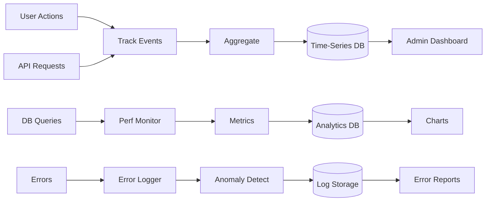

# Analytics Pipeline

Comprehensive data collection, processing, and visualization system.



## Description

Real-time analytics system tracking user behavior, performance, and errors:

### Data Sources

#### 1. User Actions
Frontend events tracked:
- **Navigation**: Page views, route changes
- **Interactions**: Button clicks, form submissions
- **Features**: Search, filters, exports
- **Session Data**: Duration, bounce rate, exit pages

**Collection Method**: Custom event tracking with privacy filtering

#### 2. API Requests
Backend metrics:
- **Endpoints**: Request count per route
- **Methods**: GET, POST, PUT, DELETE distribution
- **Response Times**: Median, P95, P99
- **Status Codes**: Success vs. error rates
- **Payload Sizes**: Request/response size tracking

**Collection Method**: Middleware logging

#### 3. Database Queries
Performance monitoring:
- **Query Time**: Execution duration
- **Slow Queries**: >1s threshold
- **Query Types**: SELECT, INSERT, UPDATE, DELETE
- **Table Access Patterns**: Most accessed tables
- **Connection Pool**: Active connections, wait times

**Collection Method**: Supabase performance insights

#### 4. Errors
Error tracking and categorization:
- **Client Errors**: JavaScript exceptions, React errors
- **Server Errors**: API failures, database errors
- **Network Errors**: Timeout, connection failures
- **Security Events**: Failed auth, blocked requests

**Collection Method**: Sentry integration

### Processing Pipeline

#### Aggregation
Event data rolled up:
- **5-minute intervals**: Real-time dashboard
- **Hourly buckets**: Recent trends
- **Daily summaries**: Historical analysis
- **Monthly reports**: Executive dashboard

#### Performance Metrics
Calculated metrics:
- **Response Time Percentiles**: P50, P90, P95, P99
- **Error Rate**: Errors per total requests
- **Availability**: Uptime percentage
- **Throughput**: Requests per second

#### Anomaly Detection
Machine learning models:
- **Spike Detection**: Unusual traffic patterns
- **Error Rate Anomalies**: Sudden error increases
- **Performance Degradation**: Slow response trends
- **Security Threats**: Attack pattern recognition

### Storage Strategy

#### Time-Series Database
Hot data (last 30 days):
- Raw events
- Fast queries
- Real-time charts
- Downsampled for older data

**Technology**: TimescaleDB extension on PostgreSQL

#### Analytics Database
Processed data:
- Aggregated metrics
- User cohorts
- Conversion funnels
- A/B test results

**Technology**: Supabase PostgreSQL with custom views

#### Log Storage
Error logs and security events:
- Full stack traces
- Request context
- User information (anonymized)
- Retention: 90 days

**Technology**: Sentry + Supabase logs

### Visualization

#### Admin Dashboard
Real-time charts:
- **Today's Overview**: Appointments, revenue, patients
- **Live Users**: Current active sessions
- **Recent Activity**: Latest actions timeline
- **Quick Stats**: KPIs at a glance

#### Charts & Reports
- **Line Charts**: Time-series trends
- **Bar Charts**: Categorical comparisons
- **Pie Charts**: Distribution visualization
- **Heatmaps**: Usage patterns by time/day
- **Funnels**: Conversion tracking

#### Custom Reports
- **Financial Reports**: Revenue, expenses, projections
- **Clinical Reports**: Treatment outcomes, patient progress
- **Operational Reports**: Staff efficiency, resource utilization
- **Compliance Reports**: HIPAA audit logs

### Key Metrics Tracked

#### Business Metrics
- Daily/Monthly Active Patients
- Appointment Booking Rate
- Revenue per Patient
- Patient Acquisition Cost
- Retention Rate

#### Operational Metrics
- Average Wait Time
- Appointment No-Show Rate
- Staff Utilization
- Treatment Duration
- Patient Satisfaction Score

#### Technical Metrics
- Page Load Time (LCP, FID, CLS)
- API Response Time
- Error Rate
- Database Query Performance
- Server CPU/Memory Usage

#### Security Metrics
- Failed Login Attempts
- Blocked IPs
- Rate Limit Violations
- Suspicious Activity Alerts

### Privacy & Compliance

#### Data Anonymization
- PII removed from analytics
- IP addresses hashed
- User IDs pseudonymized
- Medical data excluded

#### GDPR Compliance
- Right to deletion
- Data export capability
- Consent tracking
- Retention policies

#### HIPAA Considerations
- No PHI in analytics
- Aggregate data only
- Access controls
- Audit logging

### Performance Impact
- **Client Bundle**: +2KB (gzipped)
- **Server Overhead**: <5ms per request
- **Database Load**: Async writes, minimal impact
- **Network Traffic**: Batched events, <1KB/minute

### Integration

#### Vercel Analytics
- Automatic Web Vitals tracking
- Deployment analytics
- Edge function metrics

#### Vercel Speed Insights
- Real User Monitoring (RUM)
- Geographic performance data
- Device-specific insights

#### Custom Analytics API
```typescript
// Usage example
analytics.track('appointment_booked', {
  patient_id: 'xxx',
  date: '2025-01-15',
  type: 'video_consultation'
});
```

**Data Retention**: 13 months for detailed data, 5 years for aggregated reports

