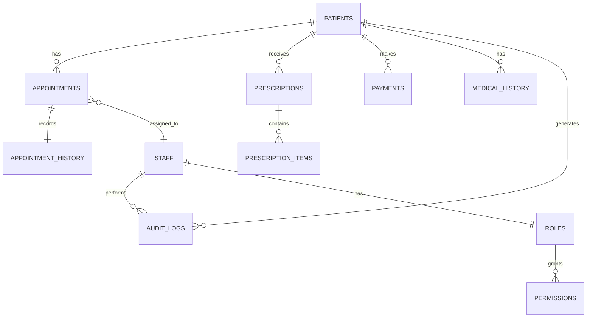

# Database Entity-Relationship Diagram

Core database schema showing relationships between main tables.

## Description

The database schema follows relational design principles with proper normalization:

### Core Tables

#### PATIENTS
Primary patient information table:
- `id` (UUID, PK)
- `patient_code` (unique, indexed)
- `first_name`, `last_name`
- `email` (unique), `phone`
- `date_of_birth`, `gender`
- `address`, `city`, `state`, `zip`
- `emergency_contact_name`, `emergency_contact_phone`
- `created_at`, `updated_at`

**Indexes**:
- `patient_code` (unique)
- `email` (unique)
- `phone` (for quick lookup)

#### APPOINTMENTS
Scheduling and appointment tracking:
- `id` (UUID, PK)
- `patient_id` (FK → PATIENTS)
- `staff_id` (FK → STAFF, nullable)
- `appointment_date`, `appointment_time`
- `duration_minutes` (default: 30)
- `type` (enum: 'clinic', 'video')
- `status` (enum: 'scheduled', 'confirmed', 'completed', 'cancelled')
- `notes`, `internal_notes`
- `created_at`, `updated_at`

**Indexes**:
- `patient_id`
- `staff_id`
- `appointment_date`
- Composite: `(appointment_date, appointment_time)` for conflict detection

**Constraints**:
- No overlapping appointments (trigger/constraint)
- Operating hours: 8 AM - 6 PM
- No appointments on Sundays

#### APPOINTMENT_HISTORY
Audit trail for appointment changes:
- `id` (UUID, PK)
- `appointment_id` (FK → APPOINTMENTS)
- `changed_by` (FK → STAFF)
- `previous_values` (JSONB)
- `new_values` (JSONB)
- `change_type` (enum: 'created', 'updated', 'cancelled')
- `changed_at` (timestamp)

#### PRESCRIPTIONS
Medication prescriptions:
- `id` (UUID, PK)
- `patient_id` (FK → PATIENTS)
- `prescribed_by` (FK → STAFF)
- `prescription_date`
- `notes`, `diagnosis`
- `status` (enum: 'active', 'completed', 'cancelled')
- `pdf_url` (Supabase Storage link)
- `created_at`, `updated_at`

#### PRESCRIPTION_ITEMS
Individual medications in prescription:
- `id` (UUID, PK)
- `prescription_id` (FK → PRESCRIPTIONS)
- `medication_name`
- `dosage`, `frequency`
- `duration_days`
- `instructions`
- `quantity`

#### PAYMENTS
Financial transactions:
- `id` (UUID, PK)
- `patient_id` (FK → PATIENTS)
- `appointment_id` (FK → APPOINTMENTS, nullable)
- `amount` (decimal)
- `currency` (default: 'USD')
- `payment_method` (enum: 'card', 'cash', 'insurance')
- `stripe_payment_id` (indexed)
- `status` (enum: 'pending', 'completed', 'failed', 'refunded')
- `receipt_url`
- `payment_date`, `created_at`

**Indexes**:
- `patient_id`
- `stripe_payment_id`
- `payment_date`

#### MEDICAL_HISTORY
Patient medical records:
- `id` (UUID, PK)
- `patient_id` (FK → PATIENTS)
- `visit_date`
- `chief_complaint`
- `soap_subjective`, `soap_objective`, `soap_assessment`, `soap_plan`
- `diagnosis_codes` (array)
- `treatment_provided`
- `provider_id` (FK → STAFF)
- `attachments` (JSONB array of file URLs)
- `created_at`, `updated_at`

#### STAFF
Healthcare providers and administrative staff:
- `id` (UUID, PK)
- `user_id` (FK → auth.users)
- `first_name`, `last_name`
- `role_id` (FK → ROLES)
- `email`, `phone`
- `specialization` (for doctors)
- `license_number`
- `is_active` (boolean)
- `created_at`, `updated_at`

#### ROLES
Role definitions for RBAC:
- `id` (UUID, PK)
- `name` (enum: 'admin', 'doctor', 'staff', 'patient')
- `description`
- `created_at`

#### PERMISSIONS
Granular permissions:
- `id` (UUID, PK)
- `role_id` (FK → ROLES)
- `resource` (e.g., 'patients', 'appointments')
- `action` (enum: 'create', 'read', 'update', 'delete')
- `conditions` (JSONB, e.g., {"owner_only": true})

#### AUDIT_LOGS
Security and compliance logging:
- `id` (UUID, PK)
- `user_id` (FK → auth.users)
- `patient_id` (FK → PATIENTS, nullable)
- `action` (e.g., 'view_record', 'update_appointment')
- `resource_type`, `resource_id`
- `ip_address`, `user_agent`
- `details` (JSONB)
- `timestamp`

**Indexes**:
- `user_id`
- `patient_id`
- `timestamp`
- Composite: `(resource_type, resource_id)`

### Relationships

#### One-to-Many
- Patient → Appointments (one patient, many appointments)
- Patient → Prescriptions
- Patient → Payments
- Patient → Medical History
- Prescription → Prescription Items
- Staff → Audit Logs
- Role → Permissions

#### Many-to-One
- Appointment → Patient
- Appointment → Staff (assigned provider)
- Prescription → Patient
- Payment → Patient

#### One-to-One
- Appointment → Appointment History (for each change)
- Staff → Role

### Security Features

#### Row-Level Security (RLS)
Supabase policies enforce:
- Patients can only see their own data
- Staff can see data based on role
- Admins have full access
- Audit logs are append-only

#### Encryption
- Sensitive fields encrypted at rest (AES-256)
- All connections use TLS 1.3
- Backup encryption enabled

### Performance Optimizations

#### Indexes
- Primary keys (automatic)
- Foreign keys (automatic)
- Frequently queried columns
- Composite indexes for common queries

#### Partitioning
- `audit_logs` table partitioned by month
- `appointments` table partitioned by year (future)

#### Caching
- Redis cache for:
  - Patient lookup by code
  - Staff schedules
  - Frequently accessed appointments

### Backup Strategy
- **Automatic**: Every 6 hours
- **Point-in-Time Recovery**: 30 days
- **Manual Backups**: Before major updates
- **Testing**: Monthly restore tests

### Migration Strategy
- Version-controlled migrations (Supabase CLI)
- Rollback capability
- Zero-downtime deployments
- Data validation after migration

**Total Tables**: 13 core tables + auth tables (Supabase managed)
**Relationships**: 15 foreign key constraints
**Storage**: Estimated 10-50GB for typical clinic (5000 patients)

